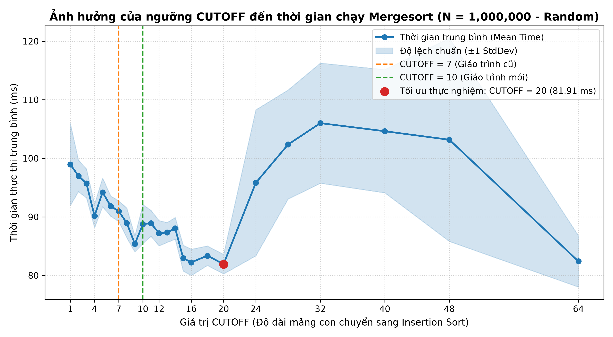
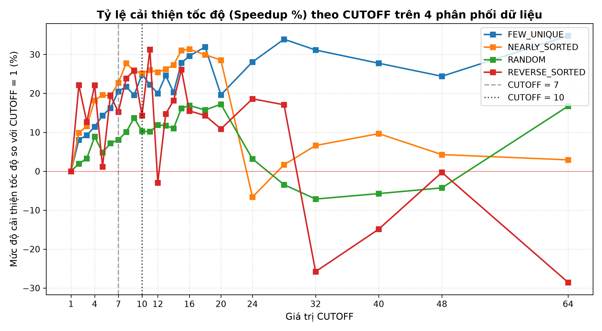

# Thí Nghiệm Khảo Sát Giá Trị CUTOFF Tối Ưu Trong Thuật Toán Mergesort

**Sinh viên thực hiện:** Bùi Quang Huy  
**Học phần:** Cấu trúc Dữ liệu và Giải thuật (Chủ đề 1.3: Algorithm Analysis & Chủ đề 2.2: Mergesort)  
**Trường:** Trường Đại học Công nghệ – ĐHQGHN (UET-VNU)

---

## 1. Giới thiệu bài toán
Thuật toán **Top-Down Mergesort** tiêu chuẩn có độ phức tạp thời gian tiệm cận $\Theta(N \log N)$, nhưng phát sinh chi phí phụ (overhead) đáng kể từ các lời gọi hàm đệ quy và thao tác sao chép mảng phụ `aux[]` khi chia nhỏ xuống các mảng con kích thước rất bé. 

Bằng cách áp dụng cải tiến **CUTOFF = $K$** (chuyển sang **Insertion Sort** khi độ dài mảng con $L = \text{hi} - \text{lo} + 1 \le K$), cây đệ quy cắt bỏ được khoảng $\log_2(K)$ tầng lá cuối cùng. Dự án này thực hiện đo lường thực nghiệm và phân tích thống kê để xác định ngưỡng `CUTOFF` tối ưu trên cấu hình phần cứng thực tế, đồng thời lý giải sự khác biệt giữa hai mốc khuyến nghị trong giáo trình Sedgewick & Wayne: **CUTOFF = 7** (bản cũ) và **CUTOFF = 10** (bản mới).

---

## 2. Cấu trúc thư mục dự án

```text
├── src/
│   ├── MergeSort.java                      # Cài đặt Mergesort có cải tiến CUTOFF (tự cài đặt từ bài giảng)
│   └── CutoffExperiment.java               # Script chạy thí nghiệm, sinh bộ test và thống kê kết quả
├── datasets/                               # Bộ dữ liệu mẫu (10,000 phần tử/file) cho 4 kịch bản phân phối
│   ├── dataset_random_10000.txt
│   ├── dataset_nearly_sorted_10000.txt
│   ├── dataset_reverse_sorted_10000.txt
│   └── dataset_few_unique_10000.txt
├── BaoCao_BuiQuangHuy.pdf # Báo cáo thí nghiệm chi tiết (Mô tả, Bảng thống kê, Đồ thị, Phân tích)
├── cutoff_results.csv                      # Dữ liệu kết quả đo thực nghiệm thô (Mean, StdDev, Min, Max, Speedup)
├── plot_results.py                         # Script Python vẽ biểu đồ từ file cutoff_results.csv
├── cutoff_random_detail.png                # Đồ thị thời gian chạy trung bình và độ lệch chuẩn trên mảng RANDOM
├── cutoff_all_distributions.png            # Đồ thị so sánh tỷ lệ tăng tốc (Speedup %) trên 4 phân phối
└── log_chat_ai.pdf                         # Nhật ký thảo luận với AI trong quá trình làm thí nghiệm
```

> 📄 **Xem toàn văn báo cáo tại đây:** [BaoCao_BuiQuangHuy.pdf](./BaoCao_BuiQuangHuy.pdf)

---

## 3. Môi trường & Phương pháp thực nghiệm

* **Vi xử lý (CPU):** 12th Gen Intel® Core™ i7-12700H (14 nhân / 20 luồng; L1 Cache 1.2 MB, L2 Cache 11.5 MB, L3 Smart Cache 24 MB; Cache Line 64 bytes = 16 số `int` 4-byte).
* **Bộ nhớ RAM:** 16 GB.
* **Hệ điều hành & JVM:** Windows 11 Pro 64-bit, OpenJDK 64-Bit Server VM (HotSpot Tiered C2 JIT Compiler).
* **Quy trình kiểm soát sai số (Chủ đề 1.3):**
  * **Kích thước khảo sát:** $N = 1,000,000$ phần tử kiểu `int` trên 24 mốc `CUTOFF` $\in \{1, 2, \dots, 64\}$.
  * **JVM Warm-up:** Chạy làm nóng 6 vòng ($N = 200,000$) trước khi bấm giờ để C2 JIT Compiler tối ưu hóa mã máy.
  * **Độc lập và Tái lập (Reproducibility):** Sử dụng hạt giống cố định `BASE_SEED = 20261110L`, tách biệt hoàn toàn thời gian sinh mảng và `Arrays.copyOf()` ra khỏi đoạn đo `System.nanoTime()`.
  * **Thống kê đa phép thử:** Lặp độc lập $T = 25$ lần (trials) tại mỗi mốc để tính trung bình mẫu ($\mu$), độ lệch chuẩn mẫu ($\sigma$) và tỷ lệ cải thiện tốc độ ($\text{Speedup \%}$) so với `CUTOFF = 1`.

---

## 4. Tóm tắt kết quả thực nghiệm

### 4.1. Bảng tổng hợp trên 4 kịch bản phân phối dữ liệu ($N = 1,000,000, T = 25$)

| Phân phối dữ liệu | Baseline $K=1$ ($\mu \pm \sigma$ ms) | `CUTOFF` tối ưu thực nghiệm | Vùng tối ưu ổn định | Cải thiện cực đại (Speedup %) | Nhận xét chính |
| :--- | :---: | :---: | :---: | :---: | :--- |
| **RANDOM** *(Ngẫu nhiên đều)* | $98.945 \pm 6.988$ | **20** ($81.913$ ms) | $8 \le K \le 20$ | **+17.21%** | Tại $K=7$ đạt $+8.06\%$, $K=10$ đạt $+10.28\%$. Vùng đáy tối ưu rơi vào $[15, 20]$ nhờ khớp với kích thước L1 Cache Line (16 số `int`). Khi $K \ge 28$, chi phí $\Theta(K^2)$ làm thuật toán chạy chậm hơn cả Mergesort thuần túy. |
| **NEARLY_SORTED** *(Gần sắp xếp)* | $32.936 \pm 0.961$ | **16** ($22.613$ ms) | $8 \le K \le 20$ | **+31.34%** | Insertion Sort đạt tiệm cận $\Theta(K)$ khi mảng gần có thứ tự, giảm mạnh chi phí copy qua mảng phụ `aux[]`. |
| **FEW_UNIQUE** *(Ít khóa phân biệt)* | $69.655 \pm 12.755$ | **18 – 28 (và 64)** ($45.42 - 46.04$ ms) | $15 \le K \le 64$ | **+34.79%** | Vòng lặp trong của Insertion Sort dừng sớm ngay khi gặp các phần tử bằng nhau, giúp duy trì hiệu năng cao ngay cả khi $K$ lớn. |
| **REVERSE_SORTED** *(Ngược thứ tự)* | $36.999 \pm 10.371$ | **8 – 11 (và 15)** ($25.441$ ms) | $8 \le K \le 15$ | **+31.24%** | Trường hợp xấu nhất của Insertion Sort ($K(K-1)/2$ phép dịch chuyển). Khi $K \ge 32$, hiệu năng suy giảm nghiêm trọng (chậm hơn baseline tới **-28.55%**). |

### 4.2. Biểu đồ trực quan

**1. Thời gian thực thi trung bình trên tập dữ liệu ngẫu nhiên (RANDOM):**


**2. So sánh tỷ lệ cải thiện tốc độ (Speedup %) trên cả 4 phân phối dữ liệu:**


---

## 5. Kết luận
1. **Trên dữ liệu ngẫu nhiên (RANDOM):** Thời gian chạy trung bình giảm từ $98.945\text{ ms}$ (`CUTOFF = 1`) xuống $90.971\text{ ms}$ tại `CUTOFF = 7` (**+8.06%**), $88.770\text{ ms}$ tại `CUTOFF = 10` (**+10.28%**), và đạt cực tiểu thực nghiệm tại **`CUTOFF = 20`** ($81.913\text{ ms}$, cải thiện **+17.21%**).
2. **Giá trị dung hòa tốt nhất (Best Compromise):** Lựa chọn **`CUTOFF` trong khoảng từ 10 đến 16** (đặc biệt `CUTOFF = 15 - 16`, vừa khít 1 Cache Line 64 bytes) là điểm cân bằng an toàn và tối ưu nhất trên mọi kịch bản dữ liệu — đạt mức tăng tốc **10% – 17%** trên mảng ngẫu nhiên, **25% – 31%** trên mảng gần sắp xếp / ít khóa phân biệt mà không bị sụt giảm hiệu năng khi gặp dữ liệu ngược thứ tự (`REVERSE_SORTED`).

---

## 6. Hướng dẫn biên dịch và chạy lại thí nghiệm

### Bước 1: Biên dịch và chạy chương trình đo thực nghiệm (Java)
Tại thư mục gốc của dự án, mở Terminal / Command Prompt và chạy:
```bash
javac -d out src/MergeSort.java src/CutoffExperiment.java
java -ea -cp out CutoffExperiment
```
*(Chương trình sẽ tự động tạo 4 bộ dữ liệu mẫu vào `./datasets/` và xuất bảng kết quả thống kê ra file `cutoff_results.csv`).*

### Bước 2: Vẽ lại đồ thị từ dữ liệu thực nghiệm (Python)
Đảm bảo đã cài đặt thư viện `pandas` và `matplotlib`, sau đó chạy:
```bash
pip install pandas matplotlib
python plot_results.py
```